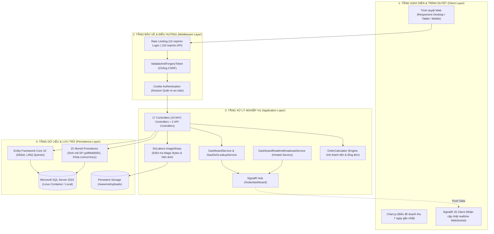
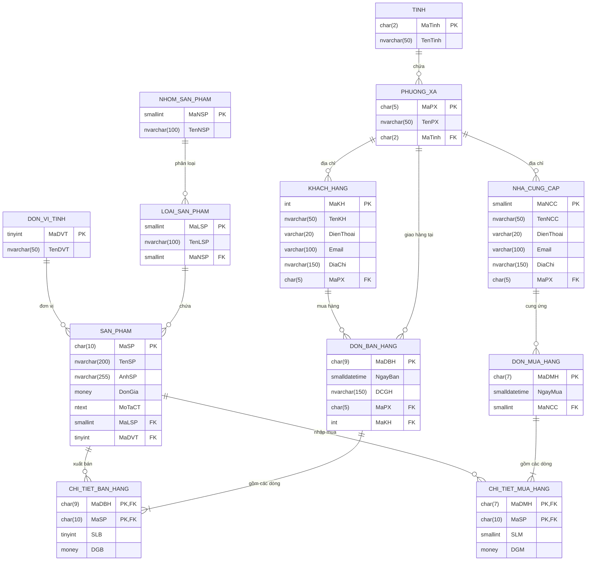
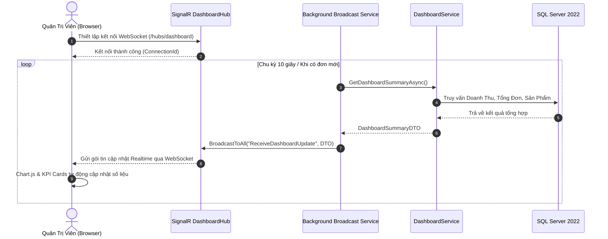

# 🛒 WebQLBH — Hệ Thống Quản Lý Bán Hàng & Phân Tích Doanh Thu Realtime

<div align="center">

[](https://github.com/nguyenxp3n/WebQLBH/actions/workflows/ci.yml)


-brightgreen?logo=xunit)


<br/>

**Ngôn ngữ / Language:** **Tiếng Việt** | [English (Secondary)](README_en.md)

</div>

> **WebQLBH** là giải pháp phần mềm quản lý bán hàng và chuỗi cung ứng thương mại xây dựng trên nền tảng **ASP.NET Core MVC (.NET 10 / C# 14)** kết hợp **Microsoft SQL Server 2022**, tích hợp cơ chế cập nhật số liệu thời gian thực qua **SignalR WebSocket**, giao diện bảng màu Slate & Emerald với hệ thống nhãn Tiếng Việt có dấu chuẩn mực, cơ chế thẩm định định dạng ảnh qua chữ ký nhị phân (Magic Bytes), và hỗ trợ xuất dữ liệu báo cáo đa định dạng (Excel / PDF / CSV).
>
> 🚀 **Triển khai môi trường thử nghiệm qua Docker Compose**: Hệ thống được đóng gói multi-container gồm Web Application và SQL Server Linux nạp sẵn dữ liệu mẫu, vận hành trơn tru và xác thực chất lượng với **30 ca kiểm thử tự động xUnit (100% Passed)** trên GitHub Actions.

---

> [!IMPORTANT]
> ### 🔑 THÔNG TIN ĐĂNG NHẬP & TRUY CẬP KIỂM THỬ (DEMO CREDENTIALS)
> Thông tin tài khoản được cấu hình sẵn trong tệp `.env.example` phục vụ mục đích kiểm thử chức năng và đánh giá kỹ thuật:
>
> | Thông số truy cập | Giá trị kiểm thử mặc định | Ghi chú & Quyền hạn |
> | :--- | :--- | :--- |
> | **🌐 Địa chỉ Web** | [http://localhost:8080](http://localhost:8080) | Chạy qua Docker Container (`webqlbh-web`) |
> | **👤 Tên đăng nhập** | `admin` | Tài khoản Quản trị viên hệ thống |
> | **🔑 Mật khẩu** | `Admin@2026!Secure` | Đã cấu hình sẵn trong file `.env.example` |
> | **🩺 Kiểm tra sức khỏe** | [http://localhost:8080/health](http://localhost:8080/health) | Trả về `HTTP 200 OK` (HealthCheck) |
> | **🗄️ SQL Server Port** | `127.0.0.1:14333` | Tài khoản: `sa` / Mật khẩu: `Password@123` |
>
> **Lệnh khởi chạy nhanh qua Docker:**
> ```bash
> # Windows PowerShell:
> Copy-Item .env.example .env
> docker compose up -d --build
>
> # Linux / macOS / Git Bash:
> cp .env.example .env
> docker compose up -d --build
> ```

---

## 📑 Mục Lục
- [1. Điểm Nhấn Công Nghệ (Tech Highlights)](#1-điểm-nhấn-công-nghệ-tech-highlights)
- [2. Danh Mục 12 Thực Thể Dữ Liệu (Domain Entity Catalog)](#2-danh-mục-12-thực-thể-dữ-liệu-domain-entity-catalog)
- [3. Danh Sách Phân Hệ & Tính Năng Nghiệp Vụ (Feature Catalog)](#3-danh-sách-phân-hệ--tính-năng-nghiệp-vụ-feature-catalog)
  - [3.1. Phân hệ Bán Hàng & Xuất Kho (Sales Operations)](#31-phân-hệ-bán-hàng--xuất-kho-sales-operations)
  - [3.2. Phân hệ Mua Hàng & Quản Trị Nhà Cung Cấp (Procurement)](#32-phân-hệ-mua-hàng--quản-trị-nhà-cung-cấp-procurement)
  - [3.3. Phân hệ Giám Sát Realtime & Dashboard SignalR](#33-phân-hệ-giám-sát-realtime--dashboard-signalr)
  - [3.4. Phân hệ Sản Phẩm & An Toàn Tải Ảnh (Magic Bytes)](#34-phân-hệ-sản-phẩm--an-toàn-tải-ảnh-magic-bytes)
  - [3.5. Phân hệ Tra Cứu Đa Tiêu Chí & Báo Cáo Đa Định Dạng](#35-phân-hệ-tra-cứu-đa-tiêu-chí--báo-cáo-đa-định-dạng)
  - [3.6. Phân hệ Quản Trị Đối Tác & Địa Giới Hành Chính](#36-phân-hệ-quản-trị-đối-tác--địa-giới-hành-chính)
  - [3.7. Phân hệ Bảo Mật, Rate Limiting & Xác Thực Quản Trị](#37-phân-hệ-bảo-mật-rate-limiting--xác-thực-quản-trị)
- [4. Sơ Đồ Kiến Trúc & Thiết Kế Hệ Thống](#4-sơ-đồ-kiến-trúc--thiết-kế-hệ-thống)
  - [4.1. Sơ Đồ Kiến Trúc Phân Tầng (Clean 4-Tier Architecture)](#41-sơ-đồ-kiến-trúc-phân-tầng-clean-4-tier-architecture)
  - [4.2. Sơ Đồ Quan Hệ Cơ Sở Dữ Liệu (Mermaid ERD - 12 Bảng)](#42-sơ-đồ-quan-hệ-cơ-sở-dữ-liệu-mermaid-erd---12-bảng)
  - [4.3. Sơ Đồ Truyền Phát Dữ Liệu Realtime (SignalR Broadcast Flow)](#43-sơ-đồ-truyền-phát-dữ-liệu-realtime-signalr-broadcast-flow)
- [5. Tiêu Chuẩn Kỹ Thuật Chuyên Sâu (Technical Deep-Dive)](#5-tiêu-chuẩn-kỹ-thuật-chuyên-sâu-technical-deep-dive)
- [6. Bộ Lệnh CLI & Vận Hành Toàn Diện (Operations & CLI Catalog)](#6-bộ-lệnh-cli--vận-hành-toàn-diện-operations--cli-catalog)
- [7. Bộ Kiểm Thử Tự Động (Automated Testing Suite - 30 Tests)](#7-bộ-kiểm-thử-tự-động-automated-testing-suite---30-tests)
- [8. Hướng Dẫn Cài Đặt & Chạy Nhanh (Quick Start)](#8-hướng-dẫn-cài-đặt--chạy-nhanh-quick-start)
- [9. Kịch Bản Trải Nghiệm Demo Trong 3 Phút (Demo Walkthrough)](#9-kịch-bản-trải-nghiệm-demo-trong-3-phút-demo-walkthrough)

---

## 1. Điểm Nhấn Công Nghệ (Tech Highlights)

* **Truyền Phát Số Liệu Realtime Không Trễ (SignalR WebSocket):** Kết hợp SignalR Hub `/hubs/dashboard` và Hosted Background Service tự động phát hiện biến động doanh thu, số lượng đơn hàng và đẩy tức thì đến client mà không cần reload trang.
* **Xử Lý Concurrency Cấp Mã Hàng Hóa Bằng Khóa Bi Quan:** Stored Procedure `SanPham_Them` tự động sinh mã định dạng ngày `yyMMdd0001` - `yyMMdd9999` với khóa độc quyền `WITH (UPDLOCK, HOLDLOCK)` và `BEGIN TRANSACTION`, triệt tiêu hoàn toàn race condition khi nhiều thủ kho cùng nhập sản phẩm đồng thời.
* **Thẩm Định Định Dạng Ảnh Bằng Chữ Ký Nhị Phân (Magic Bytes):** Đọc trực tiếp byte đầu vào của stream (JPEG `FF D8 FF`, PNG `89 50 4E 47`, GIF `47 49 46 38`, WebP `52 49 46 46`), chống tải lên mã độc webshell (.php, .exe ngụy tạo đuôi ảnh) và chuẩn hóa kích thước/nén tối ưu qua `SixLabors.ImageSharp`.
* **Động Cơ Tính Toán Nghiệp Vụ Riêng Biệt (`OrderCalculator`):** Tách biệt toàn bộ logic tính thành tiền dòng bán, dòng mua, tính tổng giá trị đơn hàng, kiểm tra tính hợp lệ dữ liệu biên (`> 0`) vào domain engine độc lập, được bảo chứng bởi 14 ca test xUnit.
* **Bảo Vệ Đa Lớp Trước Tấn Công Brute-Force & Lạm Dụng API:** Tích hợp ASP.NET Core Rate Limiter hạn chế 10 request/phút tại endpoint đăng nhập nhạy cảm và 120 request/phút cho các API giao dịch.
* **Bảo Mật Mật Khẩu Chuẩn Doanh Nghiệp (PBKDF2 HMAC-SHA256):** Khởi tạo Salt ngẫu nhiên 128-bit, 100,000 vòng lặp (iterations), cơ chế so sánh chuỗi thời gian hằng số (`FixedTimeEquals`) chống tấn công Timing Attack.
* **Xuất Báo Cáo Chuyên Nghiệp Đa Định Dạng:** Tích hợp `ClosedXML` xuất file Excel (.xlsx) định dạng bảng màu doanh nghiệp, hỗ trợ in hóa đơn PDF và xuất file CSV chuẩn UTF-8 có BOM.

---

## 2. Danh Mục 12 Thực Thể Dữ Liệu (Domain Entity Catalog)

Toàn bộ mô hình dữ liệu được chuẩn hóa trên 12 thực thể quan hệ khớp 100% với schema `database/init.sql`:

| # | Entity Model (C#) | Bảng CSDL | Khóa Chính (PK) | Khóa Ngoại (FK) & Quan Hệ | Trách Nhiệm & Vai Trò Nghiệp Vụ |
| :-: | :--- | :--- | :--- | :--- | :--- |
| 1 | `CTBH` | `dbo.CTBH` | `MaDBH` + `MaSP` | `MaDBH` $\rightarrow$ `DonBH`, `MaSP` $\rightarrow$ `SanPham` | Chi tiết đơn bán hàng: lưu số lượng xuất bán (`SLB`) và đơn giá bán thời điểm (`DGB`). Tính thành tiền qua `OrderCalculator`. |
| 2 | `CTMH` | `dbo.CTMH` | `MaDMH` + `MaSP` | `MaDMH` $\rightarrow$ `DonMH`, `MaSP` $\rightarrow$ `SanPham` | Chi tiết đơn mua hàng: lưu số lượng nhập mua (`SLM`) và đơn giá mua vốn (`DGM`). Phục vụ tính giá vốn hàng nhập. |
| 3 | `DonBH` | `dbo.DonBH` | `MaDBH` (char(9)) | `MaKH` $\rightarrow$ `KhachHang`, `MaPX` $\rightarrow$ `PhuongXa`, $1 \rightarrow N$ `CTBH` | Đơn bán hàng xuất kho: ngày bán (`NgayBan`), địa chỉ giao hàng (`DCGH`), mã khách hàng, mã phường xã nhận hàng. |
| 4 | `DonMH` | `dbo.DonMH` | `MaDMH` (char(7)) | `MaNCC` $\rightarrow$ `NhaCC`, $1 \rightarrow N$ `CTMH` | Đơn đặt hàng mua: ngày lập phiếu (`NgayMua`), nhà cung cấp đối tác. Cập nhật lịch sử nhập hàng chuỗi cung ứng. |
| 5 | `DonViTinh` | `dbo.DonViTinh` | `MaDVT` (tinyint) | $1 \rightarrow N$ `SanPham` | Danh mục đơn vị tính hàng hóa: Cái, Hộp, Thùng, Gói, Chai, Kg, Bộ... chuẩn hóa hiển thị trên toàn hệ thống. |
| 6 | `KhachHang` | `dbo.KhachHang` | `MaKH` (int IDENTITY) | `MaPX` $\rightarrow$ `PhuongXa`, $1 \rightarrow N$ `DonBH` | Hồ sơ khách hàng / đại lý: họ tên khách hàng, số điện thoại, email, địa chỉ chi tiết và địa bàn phường xã trực thuộc. |
| 7 | `LoaiSP` | `dbo.LoaiSP` | `MaLSP` (smallint) | `MaNSP` $\rightarrow$ `NhomSP`, $1 \rightarrow N$ `SanPham` | Phân loại sản phẩm cấp 2: nhóm các mặt hàng có cùng đặc tính (ví dụ: Điện thoại, Laptop, Nồi chiên...). |
| 8 | `NhaCC` | `dbo.NhaCC` | `MaNCC` (smallint) | `MaPX` $\rightarrow$ `PhuongXa`, $1 \rightarrow N$ `DonMH` | Hồ sơ nhà cung cấp: tên doanh nghiệp, số điện thoại liên hệ, email giao dịch, địa chỉ văn phòng và phường xã. |
| 9 | `NhomSP` | `dbo.NhomSP` | `MaNSP` (smallint) | $1 \rightarrow N$ `LoaiSP` | Nhóm sản phẩm cấp cao nhất: phân tầng vĩ mô ngành hàng (Thiết bị điện tử, Hàng tiêu dùng, Gia dụng...). |
| 10 | `PhuongXa` | `dbo.PhuongXa` | `MaPX` (char(5)) | `MaTinh` $\rightarrow$ `Tinh`, $1 \rightarrow N$ `KhachHang`, `NhaCC`, `DonBH` | Đơn vị hành chính cấp xã/phường: tên phường xã và liên kết với tỉnh/thành phố chủ quản. |
| 11 | `SanPham` | `dbo.SanPham` | `MaSP` (char(10)) | `MaLSP` $\rightarrow$ `LoaiSP`, `MaDVT` $\rightarrow$ `DonViTinh`, $1 \rightarrow N$ `CTBH`, `CTMH` | Danh mục hàng hóa kinh doanh: tên sản phẩm, đường dẫn ảnh (`AnhSP`), đơn giá niêm yết (`DonGia`), mô tả chi tiết (`MoTaCT`). |
| 12 | `Tinh` | `dbo.Tinh` | `MaTinh` (char(2)) | $1 \rightarrow N$ `PhuongXa` | Danh mục đơn vị hành chính cấp tỉnh / thành phố trực thuộc Trung ương trên toàn quốc. |

---

## 3. Danh Sách Phân Hệ & Tính Năng Nghiệp Vụ (Feature Catalog)

### 3.1. Phân hệ Bán Hàng & Xuất Kho (Sales Operations)
* **Quản lý đơn bán hàng (`DonBHsController`)**: Tạo đơn bán, chọn khách hàng, chỉ định địa chỉ giao hàng phường xã.
* **Chi tiết dòng xuất bán (`CTBH`)**: Thêm từng dòng sản phẩm với số lượng và đơn giá xuất; tích hợp `OrderCalculator.IsValidLineItem` thẩm định số lượng `> 0` và đơn giá `> 0`.
* **Tính toán tài chính chuẩn xác**: Tích hợp `OrderCalculator.TinhThanhTienBan` và `TinhTongThanhTien` hiển thị số tiền chính xác trên giao diện Details và khi kết xuất hóa đơn.
* **Tự động phát tín hiệu Realtime**: Sau khi tạo hoặc cập nhật đơn hàng, hệ thống phát tín hiệu qua SignalR cập nhật ngay lập tức chỉ số doanh thu trên màn hình Dashboard của các quản trị viên khác.

### 3.2. Phân hệ Mua Hàng & Quản Trị Nhà Cung Cấp (Procurement)
* **Quản lý đơn nhập mua (`DonMHsController`)**: Lập phiếu mua hàng từ các nhà cung cấp uy tín, ghi nhận ngày nhập và số hiệu đơn mua.
* **Chi tiết dòng nhập mua (`CTMH`)**: Ghi nhận số lượng nhập kho và đơn giá mua vốn; kiểm tra dữ liệu biên qua `OrderCalculator.TinhThanhTienMua`.
* **Quản trị nhà cung ứng (`NhaCCsController`)**: Tra cứu lịch sử cung cấp hàng hóa, quản lý thông tin hợp đồng và địa chỉ giao dịch.

### 3.3. Phân hệ Giám Sát Realtime & Dashboard SignalR
* **Bảng điều khiển chỉ số kinh doanh (`HomeController`)**: Hiển thị tổng quan doanh thu ngày, doanh thu tháng, tổng đơn bán, tổng khách hàng mới với màu sắc phân cấp Slate & Emerald.
* **Biểu đồ biến động doanh thu 7 ngày (`Chart.js`)**: Biểu đồ trực quan xu hướng tăng trưởng doanh thu theo tuần.
* **Cơ chế cập nhật tự động (Background Broadcast)**: `DashboardRealtimeBroadcastService` định kỳ truy vấn tổng quan và truyền phát gói tin JSON qua WebSocket tới toàn bộ máy khách đang kết nối.

### 3.4. Phân hệ Sản Phẩm & An Toàn Tải Ảnh (Magic Bytes)
* **Quản lý danh mục hàng hóa (`SanPhamsController`)**: CRUD sản phẩm, phân loại theo nhóm, loại sản phẩm và đơn vị tính.
* **Tự động sinh mã hàng độc quyền**: Gọi Stored Procedure `SanPham_Them` sinh mã định dạng `yyMMdd0001` - `yyMMdd9999` với khóa bi quan `WITH (UPDLOCK, HOLDLOCK)`, bảo vệ toàn vẹn chuỗi số thứ tự.
* **Thẩm định tệp tải lên qua Magic Bytes**: Đọc trực tiếp header nhị phân của tệp (JPEG `FF D8 FF`, PNG `89 50 4E 47`, GIF `47 49 46 38`, WebP `52 49 46 46`), từ chối tuyệt đối các file mã độc đổi đuôi giả mạo.
* **Chuẩn hóa kích thước & Nén ảnh**: Ứng dụng `SixLabors.ImageSharp` tự động nén ảnh chất lượng cao và loại bỏ siêu dữ liệu nhạy cảm (EXIF strip).

### 3.5. Phân hệ Tra Cứu Đa Tiêu Chí & Báo Cáo Đa Định Dạng
* **Tra cứu sản phẩm thông minh (`TraCuuController`)**: Lọc tức thời theo từ khóa tên sản phẩm, danh mục loại hàng, và popover chọn khoảng giá linh hoạt không che khuất bảng dữ liệu.
* **Báo cáo phân tích doanh thu (`BaoCaoController`)**: Thống kê số lượng nhóm, loại, mặt hàng, giá trung bình, giá cao nhất/thấp nhất theo ngành hàng.
* **Xuất báo cáo đa kênh (`XuatDuLieuController`)**:
  * **Excel (.xlsx)**: Sử dụng thư viện `ClosedXML` xuất báo cáo doanh số, bảng kê sản phẩm với tiêu đề in đậm, đường viền và định dạng số tiền tệ chuyên nghiệp.
  * **PDF**: Xuất phiếu thu / hóa đơn bán hàng cho khách hàng.
  * **CSV**: Xuất file dạng văn bản phân tách dấu phẩy chuẩn UTF-8 có BOM tương thích tốt với Excel tiếng Việt.

### 3.6. Phân hệ Quản Trị Đối Tác & Địa Giới Hành Chính
* **Hợp nhất đối tác (`DoiTacController`)**: Giao diện tổng quan cho phép xem nhanh cả khách hàng và nhà cung cấp trên một màn hình quản trị.
* **Phân cấp địa lý 2 tầng (`Tinh` $\rightarrow$ `PhuongXa`)**: Quản lý địa bàn giao hàng và phân tích mật độ đơn hàng theo từng khu vực địa lý.

### 3.7. Phân hệ Bảo Mật, Rate Limiting & Xác Thực Quản Trị
* **Xác thực Cookie Authentication (`AccountController`)**: Quản lý phiên đăng nhập an toàn, mã hóa ticket xác thực.
* **Mã hóa PBKDF2 HMAC-SHA256**: 100,000 iterations với Salt 128-bit, kiểm tra mật khẩu bằng thuật toán so sánh thời gian hằng số (`FixedTimeEquals`) chống rò rỉ kênh phụ.
* **Rate Limiting Middleware**: Giới hạn tối đa 10 lượt đăng nhập/phút trên mỗi IP để ngăn chặn tấn công vét cạn (Brute-Force), và 120 lượt gọi/phút cho các API giao dịch.
* **Chống giả mạo request (Anti-CSRF)**: 100% form POST được bảo vệ bằng `@Html.AntiForgeryToken()` và kiểm tra token chặt chẽ tại Controller.

---

## 4. Sơ Đồ Kiến Trúc & Thiết Kế Hệ Thống

### 4.1. Sơ Đồ Kiến Trúc Phân Tầng (Clean 4-Tier Architecture)



---

### 4.2. Sơ Đồ Quan Hệ Cơ Sở Dữ Liệu (Mermaid ERD - 12 Bảng)



---

### 4.3. Sơ Đồ Truyền Phát Dữ Liệu Realtime (SignalR Broadcast Flow)



---

## 5. Tiêu Chuẩn Kỹ Thuật Chuyên Sâu (Technical Deep-Dive)

### 5.1. Khóa Bi Quan `WITH (UPDLOCK, HOLDLOCK)` Trong Cấp Mã Sản Phẩm
Khi hệ thống có nhiều nhân viên kho tạo sản phẩm mới cùng lúc:
* **Nguy cơ**: Hai tiến trình đọc cùng một số thứ tự lớn nhất dẫn đến trùng mã `MaSP` và gây lỗi khóa chính (Primary Key Violation).
* **Giải pháp trong Stored Procedure `SanPham_Them`** (`database/init.sql` dòng 578–618):
  ```sql
  BEGIN TRANSACTION;
  SET XACT_ABORT ON;

  -- Khóa dải mã ngày hiện tại bằng UPDLOCK, HOLDLOCK
  SELECT @NextSeq = ISNULL(MAX(CAST(RIGHT(MaSP, 4) AS INT)), 0) + 1
  FROM dbo.SAN_PHAM WITH (UPDLOCK, HOLDLOCK)
  WHERE MaSP LIKE @Prefix + '%';

  SET @MaSP = @Prefix + RIGHT('0000' + CAST(@NextSeq AS VARCHAR(4)), 4);

  INSERT INTO dbo.SAN_PHAM (MaSP, TenSP, MaLSP, MaDVT, DonGia, MoTaCT, AnhSP)
  VALUES (@MaSP, @TenSP, @MaLSP, @MaDVT, @DonGia, @MoTaCT, @AnhSP);

  COMMIT TRANSACTION;
  ```
* Cơ chế này đảm bảo mọi giao dịch đồng thời đều phải xếp hàng đợi, bảo đảm cấp mã `yyMMdd0001` tuần tự 100%.

### 5.2. Thẩm Định File Ảnh Bằng Chữ Ký Nhị Phân (Magic Bytes)
Kẻ tấn công có thể đổi đuôi file mã độc thực thi `shell.php` hoặc `trojan.exe` thành `avatar.jpg` để vượt qua bộ lọc phần mở rộng.
* **Giải pháp**: Phương thức `IsValidImageHeader` đọc trực tiếp các byte đầu tiên từ Stream:
  ```csharp
  // Kiểm tra chữ ký nhị phân trực tiếp từ buffer
  var isJpeg = header[0] == 0xFF && header[1] == 0xD8 && header[2] == 0xFF;
  var isPng  = header[0] == 0x89 && header[1] == 0x50 && header[2] == 0x4E && header[3] == 0x47;
  var isWebP = header[0] == 0x52 && header[1] == 0x49 && header[2] == 0x46 && header[3] == 0x46;
  ```
* Nếu không trùng khớp với chữ ký định dạng ảnh hợp lệ, hệ thống từ chối lưu tệp ngay lập tức và ghi log cảnh báo.

### 5.3. Động Cơ Tính Toán Tài Chính Tách Biệt (`OrderCalculator`)
Thay vì viết rải rác công thức nhân chia trong Controllers hoặc Razor Views, toàn bộ phép tính được đóng gói tại [`OrderCalculator.cs`](Hoàng%20Chiếm%20Nguyên_65132292/WEB/WebQLBH_65132292/Infrastructure/OrderCalculator.cs):
* `TinhThanhTienBan(int slb, decimal dgb) => (slb > 0 && dgb > 0) ? slb * dgb : 0;`
* `TinhThanhTienMua(int slm, decimal dgm) => (slm > 0 && dgm > 0) ? slm * dgm : 0;`
* `TinhTongThanhTien(IEnumerable<decimal> items) => items?.Sum() ?? 0;`
* `IsValidLineItem(int quantity, decimal unitPrice) => quantity > 0 && unitPrice > 0;`
Toàn bộ logic này được kiểm thử độc lập bởi 14 ca test tại `BusinessCalculationTests.cs`.

---

## 6. Bộ Lệnh CLI & Vận Hành Toàn Diện (Operations & CLI Catalog)

Bảng tổng hợp toàn bộ câu lệnh vận hành cho kỹ sư phần mềm và nhà tuyển dụng:

| Phân Nhóm | Câu Lệnh CLI | Mô Tả Mục Đích Thực Thi |
| :--- | :--- | :--- |
| **Docker Compose** | `docker compose up -d --build` | Biên dịch và khởi chạy toàn bộ cụm container (Web App + SQL Server) dưới nền. |
| **Docker Compose** | `docker compose ps` | Kiểm tra tình trạng sức khỏe (healthy/running) và port mapping của các container. |
| **Docker Compose** | `docker compose logs -f webqlbh-web` | Theo dõi trực tiếp log hoạt động của ứng dụng ASP.NET Core theo thời gian thực. |
| **Docker Compose** | `docker compose logs -f webqlbh-db` | Theo dõi log nạp dữ liệu và phục hồi cơ sở dữ liệu của SQL Server. |
| **Docker Compose** | `docker compose down -v` | Dừng và xóa toàn bộ container kèm theo ổ đĩa dữ liệu (Reset môi trường sạch). |
| **Chạy Kiểm Thử** | `dotnet test tests/WebQLBH.Tests/WebQLBH.Tests.csproj` | Chạy toàn bộ **30 bài kiểm thử tự động (xUnit)** trên project test. |
| **Kiểm Thử Đơn Lẻ** | `dotnet test --filter "FullyQualifiedName~BusinessCalculationTests"` | Chạy riêng 14 bài test kiểm tra logic tính toán tài chính của `OrderCalculator`. |
| **Kiểm Thử Bảo Mật** | `dotnet test --filter "FullyQualifiedName~PasswordSecurityTests"` | Chạy các bài test mã hóa PBKDF2 và cơ chế so sánh chuỗi thời gian hằng số. |
| **Biên Dịch Dự Án** | `dotnet build tests/WebQLBH.Tests/WebQLBH.Tests.csproj -c Release` | Biên dịch solution và test harness ở cấu hình tối ưu Release. |
| **Chạy Web Cục Bộ** | `dotnet run --project "Hoàng Chiếm Nguyên_65132292/WEB/WebQLBH_65132292/DbQLBH_65132292.csproj"` | Khởi chạy máy chủ phát triển Kestrel tại máy cục bộ (port 5000/5001). |
| **Khởi Tạo CSDL** | `sqlcmd -S 127.0.0.1,14333 -U sa -P Password@123 -i database/init.sql` | Nạp thủ công schema 12 bảng, 15 stored procedures và seed data vào SQL Server. |
| **GitHub Actions** | `gh run list --workflow=ci.yml` | Tra cứu danh sách các lần thực thi CI pipeline trên repository GitHub. |
| **GitHub Actions** | `gh run view <run-id> --log` | Xem log chi tiết từng bước của quá trình build và test tự động trên cloud. |

---

## 7. Bộ Kiểm Thử Tự Động (Automated Testing Suite - 30 Tests)

Dự án sở hữu bộ kiểm thử tự động toàn diện được viết bằng **xUnit** và **FluentAssertions** tại thư mục `tests/WebQLBH.Tests`:

```text
Passed!  - Failed: 0, Passed: 30, Skipped: 0, Total: 30, Duration: 2s - WebQLBH.Tests.dll (net10.0)
```

| Test Suite | Phạm Vi Kiểm Tra Nghiệp Vụ | Số Lượng Ca Test |
| :--- | :--- | :---: |
| `BusinessCalculationTests` | Kiểm thử lớp `OrderCalculator`: tính thành tiền dòng bán/mua, tính tổng đơn hàng, kiểm tra giá trị biên âm/bằng 0, tính tổng tập thực thể | **14 tests** |
| `HumanTextGuardTests` | Chuẩn hóa chuỗi tiếng Việt có dấu, thu gọn khoảng trắng thừa, loại bỏ ký tự điều khiển bất thường | **9 tests** |
| `OrderStatusCatalogTests` | Kiểm tra tính nhất quán danh mục trạng thái đơn hàng (`Mới`, `Đang xử lý`, `Hoàn tất`), ánh xạ class định dạng CSS | **4 tests** |
| `PasswordSecurityTests` | Xác thực thuật toán băm PBKDF2 HMAC-SHA256, độ dài Salt 128-bit, 100,000 vòng lặp, và so sánh thời gian hằng số | **3 tests** |
| **Tổng cộng** | **Bộ kiểm thử tự động xUnit bao phủ trọn vẹn logic tài chính và an toàn hệ thống** | **30 tests (100% Passed)** |

---

## 8. Hướng Dẫn Cài Đặt & Chạy Nhanh (Quick Start)

### Cách 1: Khởi chạy qua Docker Compose (Khuyến Nghị 1 Chạm)
Không yêu cầu cài đặt .NET SDK hay SQL Server cục bộ trên máy host:

```bash
# 1. Clone mã nguồn về máy:
git clone https://github.com/nguyenxp3n/WebQLBH.git
cd WebQLBH

# 2. Khởi tạo file cấu hình môi trường (.env):
# Trên Windows PowerShell:
Copy-Item .env.example .env
# Trên Linux / macOS:
cp .env.example .env

# 3. Khởi chạy toàn bộ hệ thống:
docker compose up -d --build
```

Ứng dụng sẽ sẵn sàng hoạt động tại: **`http://localhost:8080`**

---

### Cách 2: Chạy cục bộ cho Lập trình viên (.NET CLI)

```bash
# 1. Khởi tạo CSDL trong SQL Server bằng file:
database/init.sql

# 2. Chạy bộ kiểm thử tự động:
dotnet test tests/WebQLBH.Tests/WebQLBH.Tests.csproj

# 3. Chạy ứng dụng web:
dotnet run --project "Hoàng Chiếm Nguyên_65132292/WEB/WebQLBH_65132292/DbQLBH_65132292.csproj"
```

---

## 9. Kịch Bản Trải Nghiệm Demo Trong 3 Phút (Demo Walkthrough)

Dành cho Nhà tuyển dụng / Tech Lead trải nghiệm nhanh toàn bộ năng lực hệ thống:

1. **Đăng nhập quản trị**:
   * Truy cập `http://localhost:8080/dang-nhap`, đăng nhập bằng `admin` / `Admin@2026!Secure`.
2. **Trải nghiệm Dashboard Realtime**:
   * Quan sát các thẻ KPI Doanh thu ngày, Tháng, Tổng đơn hàng và Biểu đồ Chart.js 7 ngày.
   * Mở 2 tab trình duyệt song song: tạo một đơn hàng mới ở Tab 1 $\rightarrow$ Tab 2 lập tức nhảy số doanh thu mới qua **SignalR WebSocket** mà không cần F5.
3. **Thử nghiệm tải ảnh có kiểm tra Magic Bytes**:
   * Vào menu **Sản Phẩm** $\rightarrow$ bấm **Thêm mới**.
   * Thử đổi đuôi file `.txt` thành `.jpg` rồi upload $\rightarrow$ hệ thống từ chối ngay lập tức do không khớp chữ ký nhị phân.
   * Upload ảnh `.jpg` / `.png` thật $\rightarrow$ hệ thống tự động nén, chuẩn hóa kích cỡ và hiển thị trơn tru.
4. **Xuất báo cáo đa kênh**:
   * Vào menu **Xuất Dữ Liệu** $\rightarrow$ chọn xuất file **Excel (.xlsx)**: kiểm tra định dạng bảng tính sắc nét, có tiêu đề màu Emerald và định dạng số tiền tệ chuẩn.

---

## 👨‍💻 Thông Tin Dự Án & Tác Giả
* **Dự án:** Hệ Thống Quản Lý Bán Hàng & Chuỗi Cung Ứng (WebQLBH)
* **Mã nguồn:** [https://github.com/nguyenxp3n/WebQLBH](https://github.com/nguyenxp3n/WebQLBH)
* **Nền tảng:** C# 14 / .NET 10 / ASP.NET Core MVC / EF Core 10 / SQL Server 2022 / SignalR
* **Kiểm thử tự động:** xUnit (30 Unit & Logic Tests - 100% Passed)
* **Bản quyền:** Mã nguồn phục vụ mục đích học tập, nghiên cứu và chứng minh năng lực kỹ thuật trên CV cá nhân.
