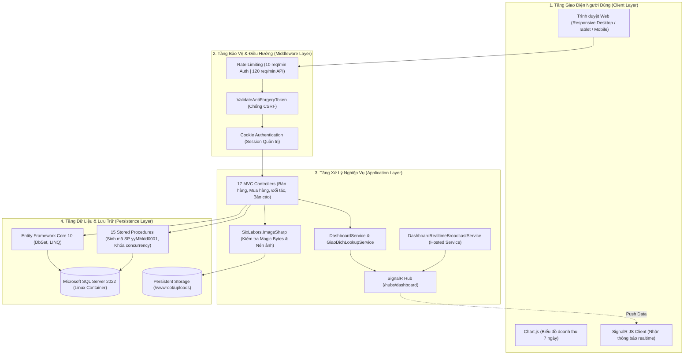
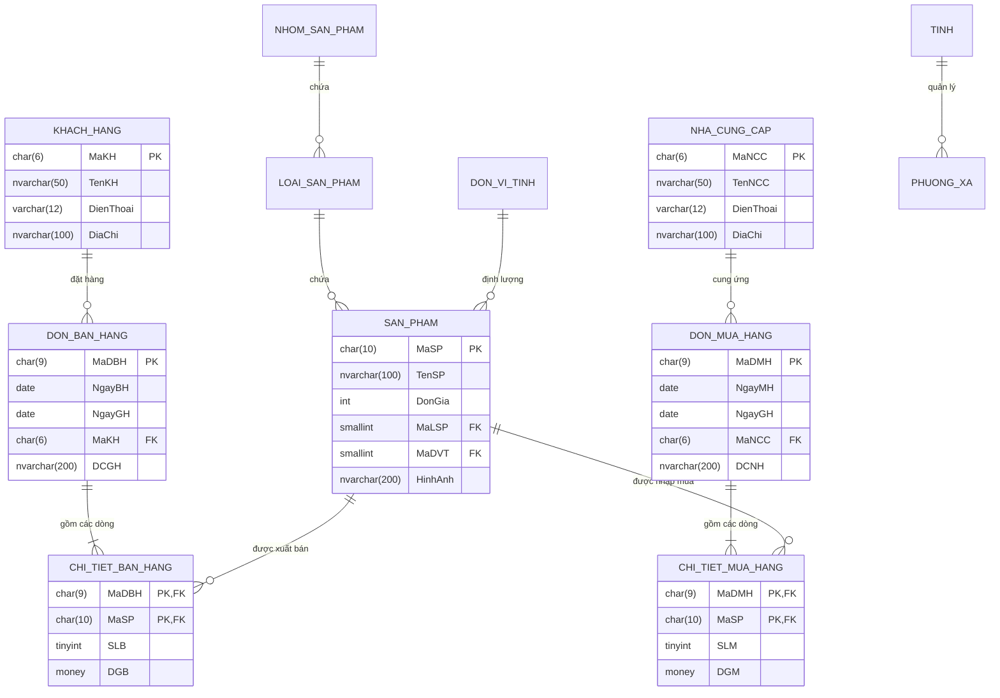

# 🛒 WebQLBH — Hệ Thống Quản Lý Bán Hàng & Phân Tích Doanh Thu Realtime

<div align="center">

[](https://dotnet.microsoft.com/)
[](https://github.com/nguyenxp3n/WebQLBH/actions/workflows/ci.yml)
[](https://www.docker.com/)
[](https://www.microsoft.com/sql-server)
[](https://dotnet.microsoft.com/apps/aspnet/signalr)
[](Hoàng%20Chiếm%20Nguyên_65132292/WEB/WebQLBH_65132292/wwwroot/css/app.css)

<br/>

**Ngôn ngữ / Language:** **Tiếng Việt** | [English (Secondary)](README_en.md)

</div>

> Hệ thống Quản lý Bán hàng & Chuỗi cung ứng xây dựng trên nền tảng **ASP.NET Core MVC** (.NET 10) và **Microsoft SQL Server 2022**, tích hợp giám sát số liệu thời gian thực qua **SignalR**, giao diện chuẩn **Enterprise Slate & Emerald** (100% tiếng Việt có dấu), cơ chế kiểm duyệt ảnh bằng mã nhận dạng nhị phân (Magic Bytes), và xuất dữ liệu đa định dạng (Excel / PDF / CSV).
>
> 🚀 **Sẵn sàng khởi chạy với 1 lệnh**: Đã được đóng gói hoàn chỉnh bằng **Docker Compose** (gồm Web Application + SQL Server Linux tự động khởi tạo dữ liệu mẫu).

---

> [!IMPORTANT]
> ### 🔑 THÔNG TIN ĐĂNG NHẬP & TRUY CẬP KIỂM THỬ (DEMO CREDENTIALS)
> Bất kỳ ai clone mã nguồn đều có thể khởi chạy và đăng nhập trải nghiệm hệ thống ngay lập tức:
>
> | Thông số truy cập | Giá trị kiểm thử mặc định | Ghi chú & Quyền hạn |
> | :--- | :--- | :--- |
> | **🌐 Địa chỉ Web** | [http://localhost:8080](http://localhost:8080) | Chạy qua Docker Container (`webqlbh-web`) |
> | **👤 Tên đăng nhập** | `admin` | Tài khoản Quản trị viên hệ thống |
> | **🔑 Mật khẩu** | `Admin@2026!Secure` | Đã cấu hình sẵn trong file `.env.example` |
> | **🩺 Kiểm tra sức khỏe** | [http://localhost:8080/health](http://localhost:8080/health) | Trả về `HTTP 200 OK` (HealthCheck) |
> | **🗄️ SQL Server Port** | `127.0.0.1:14333` | Tài khoản: `sa` / Mật khẩu: `Password@123` |
>
> **Lệnh khởi chạy nhanh qua Docker:**
> ```bash
> cp .env.example .env
> docker compose up -d
> ```

---

## 🏛️ Sơ Đồ Kiến Trúc Hệ Thống (System Architecture)



---

## 🗄️ Sơ Đồ Quan Hệ Cơ Sở Dữ Liệu (Database ERD)

Hệ thống quản lý chuỗi cung ứng bán hàng với 12 bảng thực thể và 15 Stored Procedures tối ưu hóa:



---

## 🌟 Tính Năng Kỹ Thuật Chi Tiết

### 1. 📊 Giám Sát Thời Gian Thực (Realtime Analytics)
- **Cập nhật động đa màn hình:** Sử dụng **ASP.NET Core SignalR** kết hợp Hosted Background Service để đẩy dữ liệu doanh thu, đơn hàng mới tức thời đến toàn bộ các máy trạm mà không cần tải lại trang.
- **Biểu đồ trực quan:** Tích hợp **Chart.js** hiển thị xu hướng biến động doanh thu 7 ngày gần nhất.

### 2. 🎨 Giao Diện Doanh Nghiệp (Enterprise Slate & Emerald)
- **100% Tiếng Việt có dấu:** Toàn bộ menu, tiêu đề cột, biểu mẫu nhập liệu, thông báo xác thực và modal xác nhận được chuẩn hóa ngữ pháp tiếng Việt.
- **Bảng màu & Typography:** Sử dụng tone nền Slate `#0F172A`, điểm nhấn Emerald `#059669`; phông chữ *Be Vietnam Pro* và số liệu tiền tệ hiển thị font đơn khoảng cách *JetBrains Mono*.
- **Bộ lọc giá thông minh:** Popover lựa chọn khoảng giá linh hoạt, không che khuất dữ liệu bên dưới.

### 3. 📦 Tối Ưu Hóa CSDL & 15 Stored Procedures
- **Quy trình sinh mã an toàn:** Thủ tục lưu trữ `sp_ThemSanPham` tự động sinh mã theo ngày tháng `yyMMdd0001` (độ dài 10 ký tự `CHAR(10)`), sử dụng khóa `(UPDLOCK, HOLDLOCK)` chống trùng lặp mã khi có nhiều giao dịch đồng thời.
- **Đồng bộ kiểu dữ liệu:** Đảm bảo khớp nối 100% giữa Entity Framework Core và schema SQL Server.

### 4. 🖼️ Kiểm Tra Bảo Mật Ảnh Tải Lên (Magic Bytes Validation)
- Tích hợp **SixLabors.ImageSharp** để xử lý tệp tải lên:
  - Kiểm tra **Magic Bytes** thực tế ở đầu tệp nhị phân (chỉ chấp nhận JPEG, PNG, GIF, WebP), ngăn chặn triệt để kỹ thuật giả mạo phần mở rộng tệp.
  - Tự động nén, điều chỉnh kích thước tối đa 1600px ở mức chất lượng 82% và xóa bỏ siêu dữ liệu (EXIF), ngăn chặn lưu trữ tệp độc hại thô trên máy chủ.
  - Ánh xạ thư mục lưu trữ qua Docker volume `/app/wwwroot/uploads/san-pham`.

### 5. 📑 Báo Cáo & Xuất Dữ Liệu Đa Định Dạng
- **Excel (.xlsx):** Xuất bảng kê đơn hàng, sản phẩm có định dạng tiêu đề, căn lề và độ rộng cột tự động bằng **ClosedXML**.
- **PDF:** Tạo hóa đơn vector phân giải cao bằng **QuestPDF**.
- **CSV:** Định dạng UTF-8 phục vụ xử lý và phân tích số liệu ngoại tuyến.

### 6. 🛡️ Cơ Chế Bảo Vệ Ứng Dụng
- **Băm mật khẩu an toàn:** Sử dụng `IPasswordHasher<string>` (PBKDF2 HMAC-SHA256 kèm salt ngẫu nhiên) chuẩn ASP.NET Core Identity; không lưu hoặc so sánh mật khẩu trần.
- **Giới hạn tần suất truy cập (Rate Limiting Middleware):**
  - Giới hạn **10 requests/phút** cho các endpoint xác thực `/Account/Login` nhằm chống brute-force.
  - Giới hạn **120 requests/phút** theo địa chỉ IP cho toàn bộ ứng dụng.
- **Chống giả mạo yêu cầu (CSRF):** Bảo vệ tự động với `[ValidateAntiForgeryToken]` trên tất cả các hành động POST.

---

## 🧪 Kiểm Thử Tự Động (Automated Testing & CI)

Dự án trang bị bộ kiểm thử tự động xUnit trong thư mục `tests/WebQLBH.Tests`:

| Test Suite | Phạm vi kiểm tra | Số lượng test |
| :--- | :--- | :---: |
| `HumanTextGuardTests` | Chuẩn hóa tiếng Việt, cắt khoảng trắng dư thừa, phát hiện payload độc hại | 5 tests |
| `OrderStatusCatalogTests` | Kiểm tra tính nhất quán trạng thái đơn hàng (`Mới`, `Đang xử lý`, `Hoàn tất`) và class semantic CSS | 4 tests |
| `PasswordSecurityTests` | Xác thực cơ chế băm PBKDF2 HMAC-SHA256, kiểm tra mật khẩu demo `Admin@2026!Secure` | 3 tests |
| `BusinessCalculationTests` | Kiểm tra công thức tính thành tiền dòng hàng (`Số lượng × Đơn giá`) và tổng tiền đơn hàng | 3 tests |

**Chạy kiểm thử cục bộ:**
```bash
dotnet test tests/WebQLBH.Tests/WebQLBH.Tests.csproj
```
*(Kết quả: 19/19 tests passed, 0 failures).*

Pipeline **GitHub Actions** tự động biên dịch và chạy toàn bộ test suite mỗi khi có commit mới lên nhánh `main`.

---

## 🚀 Hướng Dẫn Khởi Chạy Nhanh (Quick Start)

### Cách 1: Khởi chạy 1 lệnh bằng Docker (Khuyên Dùng)

Bạn **không cần cài đặt .NET SDK hay SQL Server**, chỉ cần cài Docker Desktop:

1. **Clone mã nguồn:**
   ```bash
   git clone https://github.com/nguyenxp3n/WebQLBH.git
   cd WebQLBH
   ```

2. **Thiết lập file cấu hình môi trường (.env):**
   ```bash
   cp .env.example .env
   ```
   *(Tệp `.env.example` đã điền sẵn tài khoản demo và mật khẩu SQL Server để chạy ngay).*

3. **Khởi chạy hệ thống:**
   ```bash
   docker compose up -d --build
   ```

4. **Truy cập ứng dụng:**
   - Mở trình duyệt: [http://localhost:8080](http://localhost:8080)
   - Đăng nhập: **`admin`** | Mật khẩu: **`Admin@2026!Secure`**

---

### Cách 2: Chạy cục bộ bằng Visual Studio (Local Development)

1. Mở file giải pháp `Hoàng Chiếm Nguyên_65132292/WEB/WebQLBH_65132292.slnx` (hoặc `.csproj`) bằng Visual Studio 2022 / 2026.
2. Đảm bảo SQL Server đang chạy và nạp script khởi tạo `database/init.sql` để tạo cơ sở dữ liệu `DbQLBH_65132292`.
3. Kiểm tra chuỗi kết nối trong `appsettings.json`.
4. Nhấn **F5** hoặc chạy lệnh `dotnet run` từ thư mục dự án.

---

## 🏗️ Cấu Trúc Thư Mục (Directory Structure)

```
WebQLBH/
├── .github/workflows/ci.yml        # Pipeline CI tự động build & test trên GitHub
├── docker-compose.yml              # Điều phối Multi-Container (Web + SQL Server)
├── .env.example                    # File mẫu cấu hình môi trường (chứa credentials demo)
├── database/                       # Dữ liệu & Kịch bản khởi tạo SQL Server
│   ├── init.sql                   # Nguồn chân lý: Schema 12 bảng, 15 SPs & Seed Data
│   ├── restore.sql                # Kịch bản khôi phục (SSMS)
│   ├── init-db.sh                 # Entrypoint tự động nạp DB an toàn cho SQL container
│   └── DbQLBH_65132292.bak        # File backup gốc cho môi trường Windows SSMS
├── tests/                          # Bộ kiểm thử tự động
│   └── WebQLBH.Tests/             # Project xUnit kiểm thử bảo mật & logic nghiệp vụ
├── Hoàng Chiếm Nguyên_65132292/    # Gói mã nguồn chính thức (Theo chuẩn nộp bài Đại học)
│   ├── DATA/                       # File dữ liệu vật lý (.mdf, .bak, script.sql)
│   └── WEB/WebQLBH_65132292/       # Ứng dụng ASP.NET Core MVC
│       ├── Controllers/            # 17 Controllers xử lý nghiệp vụ & API
│       ├── Models/                 # Entity Data Models & ViewModels
│       ├── Views/                  # Giao diện Razor Pages chuẩn tiếng Việt
│       ├── Services/               # DashboardService, GiaoDichLookupService
│       ├── Hubs/                   # SignalR Realtime Hub (/hubs/dashboard)
│       ├── Infrastructure/         # RateLimiter, HumanTextGuard, OrderCatalog
│       ├── wwwroot/                # CSS (Enterprise Slate & Emerald), JS, Uploads
│       └── Dockerfile              # Multi-stage build (.NET 10 + Thư viện đồ họa native)
```

> [!NOTE]
> **Quy chuẩn đồ án:** Thư mục mã nguồn chính được đặt tên `Hoàng Chiếm Nguyên_65132292` theo đúng quy định barem nộp bài học phần của Nhà trường. Toàn bộ cấu trúc này đã được container hóa độc lập qua Docker Compose, đảm bảo việc kiểm thử và triển khai từ bên ngoài diễn ra hoàn toàn liền mạch.
