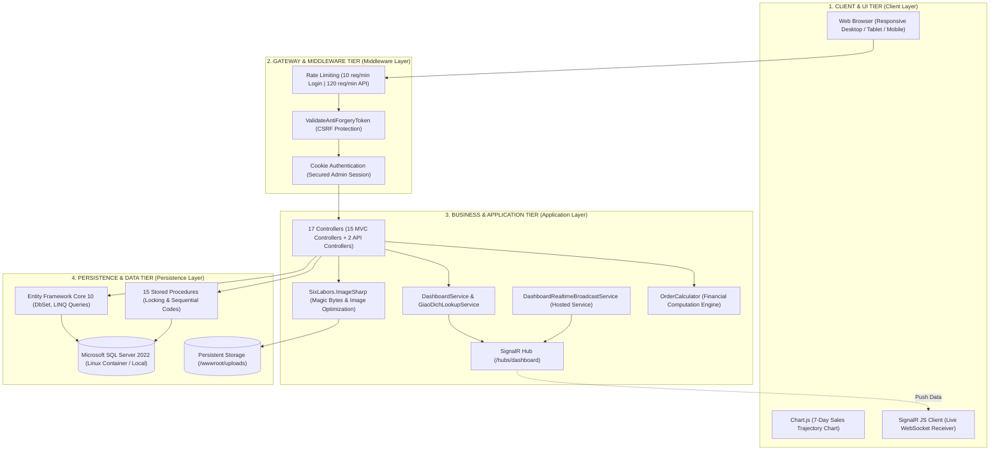
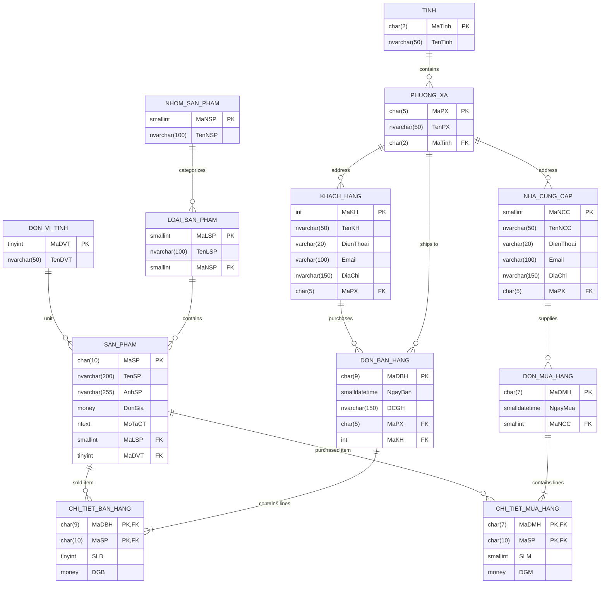
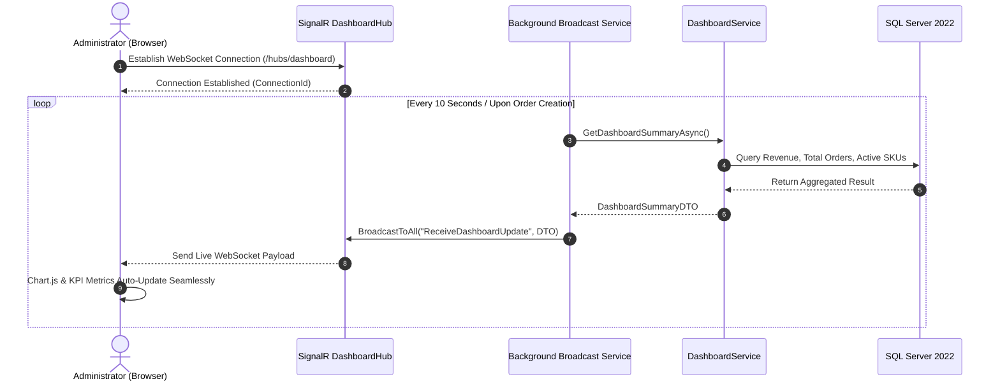

# 🛒 WebQLBH — Realtime Sales Management & Supply Chain Analytics Platform

<div align="center">

[](https://github.com/nguyenxp3n/WebQLBH/actions/workflows/ci.yml)


-brightgreen?logo=xunit)


<br/>

**Language / Ngôn ngữ:** [Tiếng Việt (Primary)](README.md) | **English**

</div>

> **WebQLBH** is an enterprise-grade commercial sales management and supply chain operations platform built on **ASP.NET Core MVC (.NET 10 / C# 14)** and **Microsoft SQL Server 2022**. It features real-time financial broadcast capabilities via **SignalR WebSocket**, a modern Slate & Emerald interface with localized terminology, binary signature validation (Magic Bytes) for secure media uploads, and multi-format report exports (Excel / PDF / CSV).
>
> 🚀 **Docker Compose Ready**: Delivered as a multi-container stack including the Web Application and SQL Server Linux populated with seed evaluation data, verified by **30 automated xUnit tests (100% Pass Rate)** on GitHub Actions CI.

---

> [!IMPORTANT]
> ### 🔑 EVALUATION & DEMO CREDENTIALS
> Standard demonstration credentials are pre-configured in `.env.example` to facilitate fast evaluation:
>
> | Parameter | Default Test Value | Notes & Privileges |
> | :--- | :--- | :--- |
> | **🌐 Web Address** | [http://localhost:8080](http://localhost:8080) | Deployed via Docker Container (`webqlbh-web`) |
> | **👤 Username** | `admin` | System Administrator Account |
> | **🔑 Password** | `Admin@2026!Secure` | Pre-configured in `.env.example` |
> | **🩺 Health Probe** | [http://localhost:8080/health](http://localhost:8080/health) | Returns `HTTP 200 OK` (HealthCheck) |
> | **🗄️ SQL Server Port** | `127.0.0.1:14333` | User: `sa` / Password: `Password@123` |
>
> **Quick Start Commands (Docker):**
> ```bash
> # Windows PowerShell:
> Copy-Item .env.example .env
> docker compose up -d --build
>
> # Linux / macOS / Git Bash:
> cp .env.example .env
> docker compose up -d --build
> ```

---

## 📑 Table of Contents
- [1. Technical Highlights](#1-technical-highlights)
- [2. 12 Domain Entities Catalog](#2-12-domain-entities-catalog)
- [3. Subsystems & Feature Catalog](#3-subsystems--feature-catalog)
  - [3.1. Sales & Outbound Order Fulfillment](#31-sales--outbound-order-fulfillment)
  - [3.2. Procurement & Supplier Restocking](#32-procurement--supplier-restocking)
  - [3.3. Realtime Analytics & SignalR Dashboard](#33-realtime-analytics--signalr-dashboard)
  - [3.4. Product Catalog & Secure Image Uploads (Magic Bytes)](#34-product-catalog--secure-image-uploads-magic-bytes)
  - [3.5. Multi-Criteria Search & Multi-Format Reporting](#35-multi-criteria-search--multi-format-reporting)
  - [3.6. Partner Management & Geographic Administrative Hierarchy](#36-partner-management--geographic-administrative-hierarchy)
  - [3.7. Security, Rate Limiting & Admin Authentication](#37-security-rate-limiting--admin-authentication)
- [4. Software Architecture & Design Diagrams](#4-software-architecture--design-diagrams)
  - [4.1. Clean 4-Tier Architecture Diagram](#41-clean-4-tier-architecture-diagram)
  - [4.2. Database Entity Relationship Diagram (Mermaid ERD - 12 Tables)](#42-database-entity-relationship-diagram-mermaid-erd---12-tables)
  - [4.3. Realtime Data Broadcast Flow (SignalR Sequence)](#43-realtime-data-broadcast-flow-signalr-sequence)
- [5. Technical Deep-Dive & Engineering Decisions](#5-technical-deep-dive--engineering-decisions)
- [6. Operations & CLI Command Catalog](#6-operations--cli-command-catalog)
- [7. Automated Testing Suite (30 Tests)](#7-automated-testing-suite-30-tests)
- [8. Quick Start Guide](#8-quick-start-guide)
- [9. 3-Minute Demo Walkthrough](#9-3-minute-demo-walkthrough)

---

## 1. Technical Highlights

* **Zero-Latency Realtime Telemetry (SignalR WebSocket):** Integrates SignalR Hub `/hubs/dashboard` with a Hosted Background Service to broadcast instant updates on revenue, order volumes, and customer spikes without manual browser refreshes.
* **Pessimistic Concurrency Code Generation:** The stored procedure `SanPham_Them` allocates item codes (`yyMMdd0001` - `yyMMdd9999`) using `WITH (UPDLOCK, HOLDLOCK)` inside an explicit transaction, eliminating race conditions during high-volume catalog entries.
* **Binary Signature Image Inspection (Magic Bytes):** Direct binary stream inspection (JPEG `FF D8 FF`, PNG `89 50 4E 47`, GIF `47 49 46 38`, WebP `52 49 46 46`) prevents disguised webshell uploads (.php, .exe disguised as images), combined with image optimization via `SixLabors.ImageSharp`.
* **Decoupled Financial Calculation Engine (`OrderCalculator`):** Encapsulates line item amounts, aggregate sales/purchase totals, and boundary conditions (`> 0`) into a standalone domain engine verified by 14 xUnit unit tests.
* **Multi-Layered Brute-Force & API Protection:** Employs ASP.NET Core Rate Limiting enforcing 10 requests/min on authentication endpoints and 120 requests/min on transactional APIs.
* **Enterprise Cryptography (PBKDF2 HMAC-SHA256):** Features 128-bit random salts, 100,000 iterations, and constant-time string comparison (`FixedTimeEquals`) to eliminate timing attack vectors.
* **Professional Multi-Format Export:** Utilizes `ClosedXML` for styled Excel (.xlsx) workbooks, supporting formatted PDF invoice receipts and UTF-8 CSV with BOM for third-party accounting integration.

---

## 2. 12 Domain Entities Catalog

Strictly normalized across 12 relational domain entities mapped directly to SQL Server:

| # | Entity Model (C#) | Database Table | Primary Key (PK) | Foreign Keys (FK) & Relations | Business Responsibility |
| :-: | :--- | :--- | :--- | :--- | :--- |
| 1 | `CTBH` | `dbo.CTBH` | `MaDBH` + `MaSP` | `MaDBH` $\rightarrow$ `DonBH`, `MaSP` $\rightarrow$ `SanPham` | Sales order line item: records sold quantity (`SLB`) and historical unit selling price (`DGB`). Calculated via `OrderCalculator`. |
| 2 | `CTMH` | `dbo.CTMH` | `MaDMH` + `MaSP` | `MaDMH` $\rightarrow$ `DonMH`, `MaSP` $\rightarrow$ `SanPham` | Purchase order line item: records received quantity (`SLM`) and purchase cost (`DGM`). Tracks cost of goods received. |
| 3 | `DonBH` | `dbo.DonBH` | `MaDBH` (char(9)) | `MaKH` $\rightarrow$ `KhachHang`, `MaPX` $\rightarrow$ `PhuongXa`, $1 \rightarrow N$ `CTBH` | Outbound sales order: order date (`NgayBan`), delivery address (`DCGH`), customer ID, and destination ward. |
| 4 | `DonMH` | `dbo.DonMH` | `MaDMH` (char(7)) | `MaNCC` $\rightarrow$ `NhaCC`, $1 \rightarrow N$ `CTMH` | Inbound purchase order: entry date (`NgayMua`), vendor partner ID. Updates inventory replenishment logs. |
| 5 | `DonViTinh` | `dbo.DonViTinh` | `MaDVT` (tinyint) | $1 \rightarrow N$ `SanPham` | Units of measurement (UoM): Piece, Box, Crate, Pack, Bottle, Kg... standardizes catalog quantity representations. |
| 6 | `KhachHang` | `dbo.KhachHang` | `MaKH` (int IDENTITY) | `MaPX` $\rightarrow$ `PhuongXa`, $1 \rightarrow N$ `DonBH` | Customer master profile: customer name, telephone number, email, street address, and administrative ward. |
| 7 | `LoaiSP` | `dbo.LoaiSP` | `MaLSP` (smallint) | `MaNSP` $\rightarrow$ `NhomSP`, $1 \rightarrow N$ `SanPham` | Product secondary category: clusters items with common characteristics (e.g., Smartphones, Laptops, Cookware). |
| 8 | `NhaCC` | `dbo.NhaCC` | `MaNCC` (smallint) | `MaPX` $\rightarrow$ `PhuongXa`, $1 \rightarrow N$ `DonMH` | Supplier profile: enterprise name, contact phone, commercial email, office address, and jurisdiction ward. |
| 9 | `NhomSP` | `dbo.NhomSP` | `MaNSP` (smallint) | $1 \rightarrow N$ `LoaiSP` | Top-level product macro division (Electronics, Consumer Goods, Household). |
| 10 | `PhuongXa` | `dbo.PhuongXa` | `MaPX` (char(5)) | `MaTinh` $\rightarrow$ `Tinh`, $1 \rightarrow N$ `KhachHang`, `NhaCC`, `DonBH` | Administrative sub-district / ward: name and parent province/city association. |
| 11 | `SanPham` | `dbo.SanPham` | `MaSP` (char(10)) | `MaLSP` $\rightarrow$ `LoaiSP`, `MaDVT` $\rightarrow$ `DonViTinh`, $1 \rightarrow N$ `CTBH`, `CTMH` | Commercial product catalog: product name, image path (`AnhSP`), unit price (`DonGia`), and technical description (`MoTaCT`). |
| 12 | `Tinh` | `dbo.Tinh` | `MaTinh` (char(2)) | $1 \rightarrow N$ `PhuongXa` | Primary administrative province / central municipality division across Vietnam. |

---

## 3. Subsystems & Feature Catalog

### 3.1. Sales & Outbound Order Fulfillment
* **Sales Order Management (`DonBHsController`)**: Create customer orders, select client profiles, and specify delivery destinations.
* **Line Item Accounting (`CTBH`)**: Adds individual line items with quantity and unit prices; enforces `OrderCalculator.IsValidLineItem` (`quantity > 0`, `unitPrice > 0`).
* **Financial Computation Accuracy**: Utilizes `OrderCalculator.TinhThanhTienBan` and `TinhTongThanhTien` for exact subtotal display and receipt formatting.
* **Automated Realtime Broadcast**: Triggering an order addition or modification prompts SignalR to broadcast fresh financial KPIs to all connected administrative dashboards.

### 3.2. Procurement & Supplier Restocking
* **Purchase Orders (`DonMHsController`)**: Registers vendor invoices, receiving dates, and purchase order identifiers.
* **Purchase Order Lines (`CTMH`)**: Records received stock quantities and purchase unit costs, verified via `OrderCalculator.TinhThanhTienMua`.
* **Vendor Directory (`NhaCCsController`)**: Manages supplier terms, historical supply activities, and legal office locations.

### 3.3. Realtime Analytics & SignalR Dashboard
* **Executive Metrics Dashboard (`HomeController`)**: Summarizes daily revenue, monthly sales, total order counts, and new customer registrations in a high-contrast Slate & Emerald layout.
* **7-Day Sales Trend (`Chart.js`)**: Interactive visual trend analysis tracking weekly revenue trajectories.
* **Background Telemetry Service**: `DashboardRealtimeBroadcastService` continuously aggregates operational KPIs and pushes WebSocket payloads to client browsers.

### 3.4. Product Catalog & Secure Image Uploads (Magic Bytes)
* **Merchandise Directory (`SanPhamsController`)**: Complete CRUD capabilities organized by macro-groups, categories, and units of measurement.
* **Concurrency-Safe Sequence Generation**: Triggers stored procedure `SanPham_Them` allocating `yyMMdd0001` - `yyMMdd9999` using `WITH (UPDLOCK, HOLDLOCK)`.
* **Magic Bytes Binary Inspection**: Inspects raw buffer headers (JPEG `FF D8 FF`, PNG `89 50 4E 47`, GIF `47 49 46 38`, WebP `52 49 46 46`), blocking disguised executable files.
* **Image Normalization & EXIF Strip**: Leverages `SixLabors.ImageSharp` for responsive compression, thumbnail scaling (max 1200px), and metadata stripping.

### 3.5. Multi-Criteria Search & Multi-Format Reporting
* **Intelligent Product Filtering (`TraCuuController`)**: Instant keyword search, category filtering, and flexible price-bracket popovers that avoid obscuring table records.
* **Sales Analytics Reporting (`BaoCaoController`)**: Computes category distributions, average pricing, and highest/lowest margins across product lines.
* **Multi-Format Export Engine (`XuatDuLieuController`)**:
  * **Excel (.xlsx)**: Produces formatted spreadsheets via `ClosedXML` with Emerald-accented headers and currency masks.
  * **PDF Receipts**: Renders printable transaction summaries.
  * **CSV**: Generates UTF-8 with BOM text data for external accounting integration.

### 3.6. Partner Management & Geographic Administrative Hierarchy
* **Unified Partner Hub (`DoiTacController`)**: Single pane of glass managing both upstream suppliers and downstream customer accounts.
* **2-Tier Geographic Hierarchy (`Tinh` $\rightarrow$ `PhuongXa`)**: Organizes shipping logistics and territory fulfillment analytics.

### 3.7. Security, Rate Limiting & Admin Authentication
* **Cookie Authentication (`AccountController`)**: Encrypted session authentication cookies with sliding expirations.
* **PBKDF2 HMAC-SHA256 Cryptography**: 100,000 iterations over 128-bit salts, utilizing constant-time comparisons (`FixedTimeEquals`) to eliminate side-channel timing leaks.
* **Rate Limiting Middleware**: Limits login attempts to 10 requests/minute per IP, and API endpoints to 120 requests/minute.
* **Anti-CSRF Protection**: Enforces `@Html.AntiForgeryToken()` across all HTTP POST actions.

---

## 4. Software Architecture & Design Diagrams

### 4.1. Clean 4-Tier Architecture Diagram



---

### 4.2. Database Entity Relationship Diagram (Mermaid ERD - 12 Tables)



---

### 4.3. Realtime Data Broadcast Flow (SignalR Sequence)



---

## 5. Technical Deep-Dive & Engineering Decisions

### 5.1. Pessimistic Concurrency via `WITH (UPDLOCK, HOLDLOCK)`
During heavy inventory intake sessions:
* **Failure Risk**: Two warehouse clerks submitting new items simultaneously read the same maximum integer sequence, generating duplicate `MaSP` primary keys and throwing database constraint violations.
* **Stored Procedure Implementation** (`SanPham_Them` in `database/init.sql` lines 578–618):
  ```sql
  BEGIN TRANSACTION;
  SET XACT_ABORT ON;

  -- Lock current date prefix range via UPDLOCK, HOLDLOCK
  SELECT @NextSeq = ISNULL(MAX(CAST(RIGHT(MaSP, 4) AS INT)), 0) + 1
  FROM dbo.SAN_PHAM WITH (UPDLOCK, HOLDLOCK)
  WHERE MaSP LIKE @Prefix + '%';

  SET @MaSP = @Prefix + RIGHT('0000' + CAST(@NextSeq AS VARCHAR(4)), 4);

  INSERT INTO dbo.SAN_PHAM (MaSP, TenSP, MaLSP, MaDVT, DonGia, MoTaCT, AnhSP)
  VALUES (@MaSP, @TenSP, @MaLSP, @MaDVT, @DonGia, @MoTaCT, @AnhSP);

  COMMIT TRANSACTION;
  ```
* Ensures sequential queueing for overlapping inserts, guaranteeing zero duplicate product identifiers.

### 5.2. Binary Header Verification (Magic Bytes)
Attackers frequently disguise webshells (`cmd.php`, `trojan.exe`) with fake `.jpg` extensions to bypass extension whitelists.
* **Engineering Solution**: The `IsValidImageHeader` method inspects leading stream bytes directly:
  ```csharp
  var isJpeg = header[0] == 0xFF && header[1] == 0xD8 && header[2] == 0xFF;
  var isPng  = header[0] == 0x89 && header[1] == 0x50 && header[2] == 0x4E && header[3] == 0x47;
  var isWebP = header[0] == 0x52 && header[1] == 0x49 && header[2] == 0x46 && header[3] == 0x46;
  ```
* Uploads failing header validation are rejected immediately prior to disk writes.

### 5.3. Standalone Financial Calculation Engine (`OrderCalculator`)
Business math is kept completely decoupled from MVC controllers and views inside [`OrderCalculator.cs`](Hoàng%20Chiếm%20Nguyên_65132292/WEB/WebQLBH_65132292/Infrastructure/OrderCalculator.cs):
* `TinhThanhTienBan(int slb, decimal dgb) => (slb > 0 && dgb > 0) ? slb * dgb : 0;`
* `TinhThanhTienMua(int slm, decimal dgm) => (slm > 0 && dgm > 0) ? slm * dgm : 0;`
* `TinhTongThanhTien(IEnumerable<decimal> items) => items?.Sum() ?? 0;`
* `IsValidLineItem(int quantity, decimal unitPrice) => quantity > 0 && unitPrice > 0;`
Guaranteed by 14 unit test cases in `BusinessCalculationTests.cs`.

---

## 6. Operations & CLI Command Catalog

Comprehensive operational command reference for software engineers and hiring evaluators:

| Category | CLI Command | Purpose & Description |
| :--- | :--- | :--- |
| **Docker Compose** | `docker compose up -d --build` | Compiles and starts the multi-container stack (Web + SQL Server) in background. |
| **Docker Compose** | `docker compose ps` | Checks health status, uptime, and port mappings across containers. |
| **Docker Compose** | `docker compose logs -f webqlbh-web` | Streams live runtime logs of the ASP.NET Core web application. |
| **Docker Compose** | `docker compose logs -f webqlbh-db` | Streams SQL Server initialization and database restore logs. |
| **Docker Compose** | `docker compose down -v` | Shuts down containers and purges storage volumes for clean resets. |
| **Run Tests** | `dotnet test tests/WebQLBH.Tests/WebQLBH.Tests.csproj` | Executes all **30 automated xUnit tests** with comprehensive coverage. |
| **Single Suite** | `dotnet test --filter "FullyQualifiedName~BusinessCalculationTests"` | Runs financial calculation and boundary tests on `OrderCalculator`. |
| **Security Tests** | `dotnet test --filter "FullyQualifiedName~PasswordSecurityTests"` | Validates PBKDF2 cryptography and constant-time string comparisons. |
| **Build Project** | `dotnet build tests/WebQLBH.Tests/WebQLBH.Tests.csproj -c Release` | Compiles the application and test harness in Release mode. |
| **Run Locally** | `dotnet run --project "Hoàng Chiếm Nguyên_65132292/WEB/WebQLBH_65132292/DbQLBH_65132292.csproj"` | Starts local Kestrel web development server (ports 5000/5001). |
| **Initialize DB** | `sqlcmd -S 127.0.0.1,14333 -U sa -P Password@123 -i database/init.sql` | Manually loads the 12-table schema, 15 stored procedures, and seed data. |
| **GitHub Actions** | `gh run list --workflow=ci.yml` | Displays recent continuous integration workflow runs on GitHub. |
| **GitHub Actions** | `gh run view <run-id> --log` | Inspects full cloud build and automated testing execution logs. |

---

## 7. Automated Testing Suite (30 Tests)

The test suite is built on **xUnit** and **FluentAssertions** located under `tests/WebQLBH.Tests`:

```text
Passed!  - Failed: 0, Passed: 30, Skipped: 0, Total: 30, Duration: 2s - WebQLBH.Tests.dll (net10.0)
```

| Test Suite | Business Scope & Assertions | Test Cases |
| :--- | :--- | :---: |
| `BusinessCalculationTests` | `OrderCalculator` engine: sales/purchase line computations, grand totals, zero/negative boundary guards, entity-collection summations | **14 tests** |
| `HumanTextGuardTests` | Vietnamese text sanitization, whitespace compaction, irregular control character filtering | **9 tests** |
| `OrderStatusCatalogTests` | Consistency of order status catalog (`Mới`, `Đang xử lý`, `Hoàn tất`), semantic CSS badge mapping | **4 tests** |
| `PasswordSecurityTests` | PBKDF2 HMAC-SHA256 password hashing, 128-bit salt length, 100,000 iterations, constant-time verification | **3 tests** |
| **Total** | **Automated xUnit test suite covering financial logic, text sanitization, and system security** | **30 tests (100% Passed)** |

---

## 8. Quick Start Guide

### Method 1: Docker Compose (Recommended 1-Click Launch)
No local .NET SDK or SQL Server installation required on host machine:

```bash
# 1. Clone repository:
git clone https://github.com/nguyenxp3n/WebQLBH.git
cd WebQLBH

# 2. Setup environment configuration (.env):
# Windows PowerShell:
Copy-Item .env.example .env
# Linux / macOS:
cp .env.example .env

# 3. Launch multi-container stack:
docker compose up -d --build
```

The application is immediately available at: **`http://localhost:8080`**

---

### Method 2: Local Developer Run (.NET CLI)

```bash
# 1. Initialize database in SQL Server via:
database/init.sql

# 2. Run automated test suite:
dotnet test tests/WebQLBH.Tests/WebQLBH.Tests.csproj

# 3. Launch Kestrel web application:
dotnet run --project "Hoàng Chiếm Nguyên_65132292/WEB/WebQLBH_65132292/DbQLBH_65132292.csproj"
```

---

## 9. 3-Minute Demo Walkthrough

Designed for Evaluators and Tech Leads to quickly review the platform:

1. **Admin Login**:
   * Navigate to `http://localhost:8080/dang-nhap`, sign in with `admin` / `Admin@2026!Secure`.
2. **Observe Realtime Dashboard**:
   * Inspect Daily Revenue, Monthly Volume, Total Orders, and 7-day Chart.js metrics.
   * Open two side-by-side browser tabs: submit an order in Tab 1 $\rightarrow$ Tab 2 auto-updates instantaneously via **SignalR WebSocket** without page reloading.
3. **Test Magic Bytes Media Upload**:
   * Open **Sản Phẩm** $\rightarrow$ click **Thêm mới**.
   * Rename a `.txt` file to `.jpg` and attempt upload $\rightarrow$ system rejects it immediately due to mismatched binary header signature.
   * Upload an authentic `.jpg` / `.png` $\rightarrow$ system automatically optimizes, scales, and displays the image smoothly.
4. **Export Multi-Channel Reports**:
   * Open **Xuất Dữ Liệu** $\rightarrow$ click **Excel (.xlsx)**: inspect the crisp table layout, Emerald headers, and currency format masks.

---

## 👨‍💻 Project & Author Information
* **Project:** Commercial Sales Management & Supply Chain Platform (WebQLBH)
* **Repository:** [https://github.com/nguyenxp3n/WebQLBH](https://github.com/nguyenxp3n/WebQLBH)
* **Stack:** C# 14 / .NET 10 / ASP.NET Core MVC / EF Core 10 / SQL Server 2022 / SignalR
* **Automated Tests:** xUnit (30 Unit & Logic Tests - 100% Passed)
* **License:** Developed for technical portfolio demonstration and academic evaluation.
