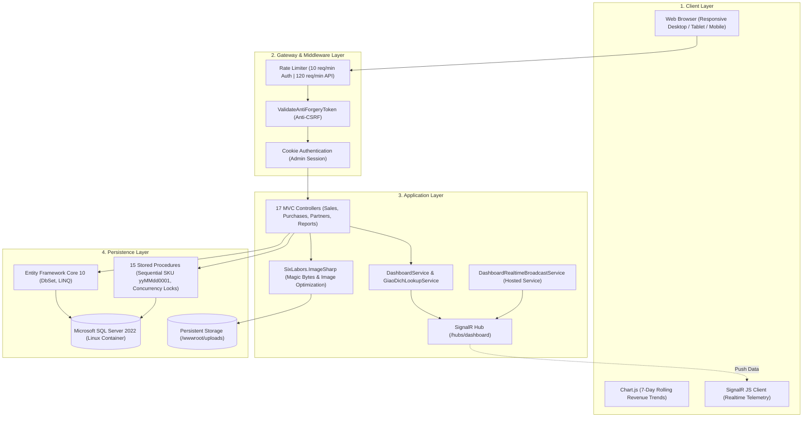
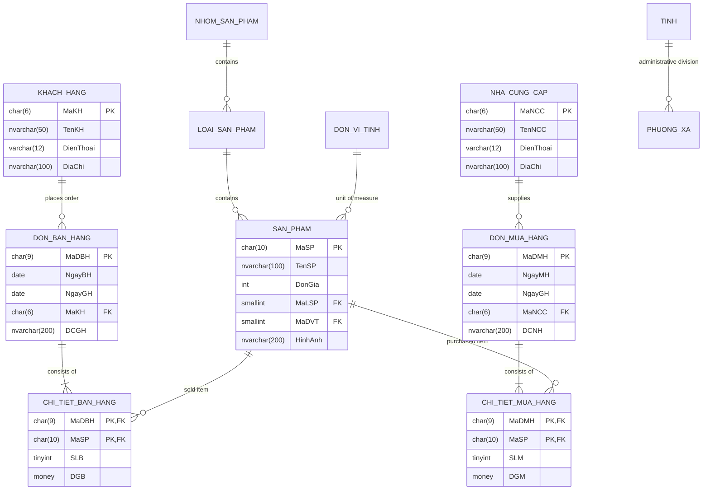

# 🛒 WebQLBH — Sales Management & Realtime Revenue Analytics System

<div align="center">

[](https://dotnet.microsoft.com/)
[](https://github.com/nguyenxp3n/WebQLBH/actions/workflows/ci.yml)
[](https://www.docker.com/)
[](https://www.microsoft.com/sql-server)
[](https://dotnet.microsoft.com/apps/aspnet/signalr)
[](Hoàng%20Chiếm%20Nguyên_65132292/WEB/WebQLBH_65132292/wwwroot/css/app.css)

<br/>

**Language / Ngôn ngữ:** [Tiếng Việt](README.md) | **English (Secondary)**

</div>

> An Enterprise Sales & Supply Chain Management System built on **ASP.NET Core MVC** (.NET 10) and **Microsoft SQL Server 2022**, featuring real-time business telemetry via **SignalR**, an enterprise-grade **Slate & Emerald design system** (standard accented Vietnamese typography), binary magic signature image verification, and multi-format document exporting (Excel / PDF / CSV).
>
> 🚀 **1-Command Turnkey Launch**: Fully containerized using **Docker Compose** (Web Application + SQL Server Linux container with automated schema seeding).

---

> [!IMPORTANT]
> ### 🔑 LIVE DEMO ACCESS & TEST CREDENTIALS
> Anyone cloning this repository can launch and explore the system immediately:
>
> | Parameter | Default Test Value | Notes & Privileges |
> | :--- | :--- | :--- |
> | **🌐 Web Address** | [http://localhost:8080](http://localhost:8080) | Running via Docker Container (`webqlbh-web`) |
> | **👤 Username** | `admin` | System Administrator Account |
> | **🔑 Password** | `Admin@2026!Secure` | Preconfigured in `.env.example` |
> | **🩺 Health Check** | [http://localhost:8080/health](http://localhost:8080/health) | Returns `HTTP 200 OK` (HealthCheck) |
> | **🗄️ SQL Server Port** | `127.0.0.1:14333` | User: `sa` / Password: `Password@123` |
>
> **Quick Start Command via Docker:**
> ```bash
> cp .env.example .env
> docker compose up -d
> ```

---

## 🏛️ System Architecture



---

## 🗄️ Database Entity-Relationship Diagram (ERD)

The relational supply chain schema comprises 12 entities and 15 optimized Stored Procedures:



---

## 🌟 Technical Highlights

### 1. 📊 Realtime Telemetry & Business Analytics
- **Multi-client telemetry:** Uses **ASP.NET Core SignalR** backed by a hosted background worker service to push instant sales order, customer, and revenue updates across all connected sessions.
- **Interactive charts:** Visualized with **Chart.js** displaying rolling 7-day revenue fluctuations with smooth Emerald gradient fills.

### 2. 🎨 Modern Enterprise UI/UX (Slate & Emerald)
- **Accented Vietnamese Typography:** All labels, form controls, validation errors, and confirmation dialogs adhere strictly to Vietnamese diacritic standards.
- **Color System & Typefaces:** Slate `#0F172A` background tones accented by Emerald `#059669`; content set in *Be Vietnam Pro* and financial figures formatted with monospace *JetBrains Mono*.
- **Smart Price Range Selector:** Floating popover filter preventing layout shifting and preserving visibility of table records.

### 3. 📦 Relational Schema & 15 Stored Procedures
- **Safe Key Generation:** `sp_ThemSanPham` generates sequential 10-character SKUs (`yyMMdd0001`, `CHAR(10)`) protected by transaction concurrency locks `(UPDLOCK, HOLDLOCK)` to prevent collisions.
- **Strict Data Typing:** Strict mapping between Entity Framework Core models and SQL Server schemas (`CHAR(10)` for `MaSP`, `SMALLINT` for `MaNSP`).

### 4. 🖼️ Binary Magic Signature Image Validation
- Powered by **SixLabors.ImageSharp**:
  - Byte-level **Magic Bytes** verification (JPEG, PNG, GIF, WebP), detecting and rejecting file extension spoofing attempts.
  - Automatic downscaling (max 1600px width/height, re-encoded at 82% quality) and stripping EXIF metadata.
  - Raw unverified files are never stored on the server file system.
  - Upload volume mapped cleanly to `/app/wwwroot/uploads/san-pham`.

### 5. 📑 Multi-Format Report Exporting
- **Excel (.xlsx):** Auto-fitted, formatted transaction registers created via **ClosedXML**.
- **PDF Documents:** High-resolution vector invoices generated using **QuestPDF**.
- **CSV Data:** UTF-8 encoded files ready for offline business intelligence tools.

### 6. 🛡️ Application Security Hardening
- **Secure Password Hashing:** Uses `IPasswordHasher<string>` (PBKDF2 HMAC-SHA256 with cryptographically random 128-bit salt) following ASP.NET Core Identity standards; plaintext comparison is strictly banned.
- **Multi-Tier Rate Limiting Middleware:**
  - `AuthPolicy`: Strict limit of **10 requests/minute** on `/Account/Login` endpoints to prevent brute-force attacks.
  - `ApiPolicy`: **120 requests/minute** per IP across general application routes.
- **Anti-Forgery / CSRF:** 100% enforced on state-modifying actions via `[ValidateAntiForgeryToken]`.

---

## 🧪 Automated Testing & CI Pipeline

The project includes an automated test suite powered by xUnit in `tests/WebQLBH.Tests`:

| Test Suite | Target Area | Number of Tests |
| :--- | :--- | :---: |
| `HumanTextGuardTests` | Vietnamese text sanitization, whitespace normalization, machine payload detection | 5 tests |
| `OrderStatusCatalogTests` | Order state machine consistency (`Mới`, `Đang xử lý`, `Hoàn tất`) and semantic CSS | 4 tests |
| `PasswordSecurityTests` | PBKDF2 HMAC-SHA256 hashing verification against default demo password `Admin@2026!Secure` | 3 tests |
| `BusinessCalculationTests` | Line-item calculation formula (`Quantity × UnitPrice`) and order total aggregation | 3 tests |

**Run tests locally:**
```bash
dotnet test tests/WebQLBH.Tests/WebQLBH.Tests.csproj
```
*(Result: 19/19 tests passed, 0 failures).*

A **GitHub Actions** workflow automatically verifies builds and executes all unit tests on every commit to `main`.

---

## 🚀 Quick Start Guide

### Option 1: 1-Command Launch with Docker (Recommended)

No need to install .NET SDK or SQL Server locally — Docker Desktop is all you need:

1. **Clone the repository:**
   ```bash
   git clone https://github.com/nguyenxp3n/WebQLBH.git
   cd WebQLBH
   ```

2. **Setup environment variables:**
   ```bash
   cp .env.example .env
   ```
   *(The `.env.example` file is pre-populated with ready-to-test credentials).*

3. **Start the multi-container stack:**
   ```bash
   docker compose up -d --build
   ```

4. **Access the application:**
   - Open browser: [http://localhost:8080](http://localhost:8080)
   - Log in: **`admin`** | Password: **`Admin@2026!Secure`**

---

### Option 2: Local Development with Visual Studio / .NET CLI

1. Open `Hoàng Chiếm Nguyên_65132292/WEB/WebQLBH_65132292.slnx` (or `.csproj`) in Visual Studio 2022 / 2026.
2. Run `database/init.sql` against your local SQL Server instance to initialize `DbQLBH_65132292`.
3. Verify connection string in `appsettings.json`.
4. Press **F5** or run `dotnet run` from the project directory.

---

## 🏗️ Architecture & Directory Structure

```
WebQLBH/
├── .github/workflows/ci.yml        # GitHub Actions CI workflow (Build & Test)
├── docker-compose.yml              # Multi-container orchestration (Web + DB)
├── .env.example                    # Environment configuration template (with demo credentials)
├── database/                       # SQL Server Data & Provisioning Scripts
│   ├── init.sql                   # Single source of truth: 12 tables, 15 SPs & seed data
│   ├── restore.sql                # Manual restore script (SSMS)
│   ├── init-db.sh                 # Safe container initialization script
│   └── DbQLBH_65132292.bak        # Original database backup file
├── tests/                          # Automated testing suite
│   └── WebQLBH.Tests/             # xUnit test project for business logic & security
├── Hoàng Chiếm Nguyên_65132292/    # Official coursework & submission root
│   ├── DATA/                       # Physical data files (.mdf, .bak, script.sql)
│   └── WEB/WebQLBH_65132292/       # ASP.NET Core MVC Application
│       ├── Controllers/            # 17 Business logic & API controllers
│       ├── Models/                 # Entity Data Models & ViewModels
│       ├── Views/                  # Razor Views (Accented Vietnamese UI)
│       ├── Services/               # DashboardService, GiaoDichLookupService
│       ├── Hubs/                   # SignalR Realtime Hub (/hubs/dashboard)
│       ├── Infrastructure/         # RateLimiter, HumanTextGuard, OrderCatalog
│       ├── wwwroot/                # CSS (Enterprise Slate & Emerald), JS, Uploads
│       └── Dockerfile              # Multi-stage build (.NET 10 + Native Graphics Libraries)
```

> [!NOTE]
> **Coursework Compliance:** The core codebase is contained within `Hoàng Chiếm Nguyên_65132292` in accordance with university grading standards. Docker Compose abstracts this internal pathing to provide a seamless root-level evaluation experience.
